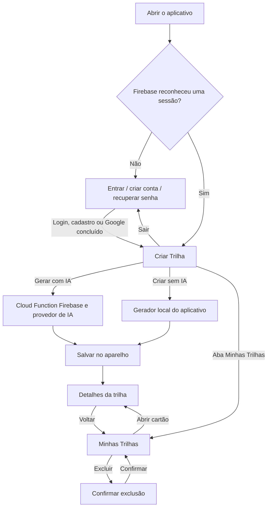

# Como o TrilhaMestre funciona

Este guia explica, em linguagem simples, como a pessoa navega pelo aplicativo, o que cada tela faz e para onde cada ação leva. É baseado nas rotas e serviços atuais do projeto.

## Visão rápida

## Quem inicia e qual é a primeira tela

1. Ao abrir, o aplicativo consulta o Firebase para saber se já existe uma sessão.
2. Enquanto verifica, mostra um indicador de carregamento.
3. **Sem sessão:** a pessoa começa na tela **Entrar na sua conta**. Ela também pode criar uma conta, recuperar a senha ou entrar com Google.
4. **Com sessão:** a pessoa acessa a área autenticada, cuja tela inicial é **Criar Trilha**.
5. Ao sair da conta, a sessão Firebase é encerrada e o aplicativo volta a exigir autenticação.

As telas protegidas são **Criar Trilha**, **Minhas Trilhas** e **Detalhes da trilha**. A proteção e a decisão entre login e área autenticada ficam no layout raiz.

## Telas e ações

### 1. Entrar, cadastrar ou recuperar senha

**Rota:** `/login`  
**Arquivo:** [`src/app/login.js`](../src/app/login.js)

Esta tela é o ponto de entrada para quem ainda não está autenticado. Ela tem três modos:

| Modo | Ação da pessoa | O que o aplicativo faz | Próximo passo |
|---|---|---|---|
| Entrar | Informa e-mail e senha e toca em **Entrar** | Confere os campos e envia as credenciais ao Firebase Authentication | Se o login funcionar, a sessão é reconhecida e abre a área autenticada |
| Criar conta | Toca em **Ainda não tenho conta · Cadastrar**, informa e-mail e senha e toca em **Criar conta** | Cria a conta no Firebase Authentication | Com a conta autenticada, abre **Criar Trilha** |
| Recuperar senha | Toca em **Esqueci minha senha**, informa e-mail e toca em **Enviar instruções** | Solicita ao Firebase o envio de um e-mail de redefinição | Continua na tela e exibe uma confirmação |
| Google | Toca em **Continuar com Google** | Abre o fluxo nativo do Google e troca o token retornado por uma credencial Firebase | Se concluir, abre **Criar Trilha** |

O link de retorno em cada modo muda somente o modo exibido na própria tela. Erros de autenticação ou de configuração aparecem nela; não há navegação para outra página nesses casos.

### 2. Criar Trilha

**Rota:** `/` (aba `index`)  
**Arquivo:** [`src/app/(tabs)/index.js`](../src/app/(tabs)/index.js)

É a tela inicial depois do login e também uma das duas abas principais. A pessoa informa:

- **Tema** (obrigatório, pelo menos 3 caracteres; limite visual de 120);
- **Objetivo** (opcional; limite visual de 240);
- **Nível:** iniciante, intermediário ou avançado;
- **Contexto extra** (opcional; limite visual de 500).

As duas ações de criação seguem caminhos diferentes:

| Ação | O que acontece | Para onde vai |
|---|---|---|
| **Gerar orientação com IA** | Valida o tema e envia tema, objetivo, nível e contexto para a função autenticada `gerarOrientacao` no Firebase. A função chama os provedores de IA configurados no servidor. | Quando a resposta válida é salva no aparelho, abre **Detalhes da trilha** |
| **Criar trilha sem IA** | Valida o tema e gera uma trilha usando os modelos e recursos que já estão no aplicativo. Não chama a função de IA. | Quando a trilha é salva no aparelho, abre **Detalhes da trilha** |

Se a validação, a geração ou o salvamento falhar, a tela mostra uma mensagem e permanece aberta para a pessoa tentar novamente. Enquanto as trilhas estão carregando, ou se o armazenamento local falhar, os botões de criação ficam desativados.

#### O que ocorre na geração com IA

1. A função do aplicativo `gerarOrientacaoComIA` chama a callable Firebase `gerarOrientacao`.
2. O servidor exige uma sessão autenticada, valida os dados e verifica o limite de **10 pedidos por conta por dia**.
3. O servidor usa a ordem de provedores configurada em `AI_PROVIDER_CONFIG` (Gemini, Groq e/ou OpenRouter) e tenta o próximo se um provedor falhar.
4. A resposta precisa ter de 3 a 5 fases e de 1 a 4 etapas por fase. Os links de materiais são pesquisas no Google criadas pelo servidor, não links validados pela IA.
5. A trilha pronta volta ao aplicativo, é salva no AsyncStorage e abre na página de detalhes.

Tema, objetivo e contexto são enviados ao provedor de IA configurado. Não informe dados pessoais sensíveis. Se a função ou os provedores estiverem indisponíveis, a tela mostra o erro; a pessoa pode tentar novamente ou escolher **Criar trilha sem IA**.

#### O que ocorre na geração sem IA

O gerador local tenta identificar uma categoria a partir do tema e do texto de apoio informado (contexto; se estiver vazio, objetivo; se ambos estiverem vazios, o próprio tema). Se encontra um modelo conhecido, usa esse modelo e os recursos cadastrados no aplicativo; caso contrário, cria uma trilha genérica. A trilha resultante é salva da mesma forma que a gerada por IA.

### 3. Minhas Trilhas

**Rota:** `/historico` (aba `historico`)  
**Arquivo:** [`src/app/(tabs)/historico.js`](../src/app/(tabs)/historico.js)

Esta aba lista as trilhas salvas neste aparelho. A pessoa pode:

| Ação | O que acontece | Para onde vai |
|---|---|---|
| Buscar | Filtra pelo título, tema ou descrição enquanto digita | Continua na lista filtrada |
| Filtrar por status | Mostra todas, em andamento, pausadas ou concluídas | Continua na lista filtrada |
| Tocar em um cartão | Abre a trilha selecionada | `/trilha/{id}` |
| Tocar em **Excluir** | Abre uma confirmação do sistema | Se cancelar, a lista não muda; se confirmar, a trilha é removida do armazenamento local |

Cada cartão mostra nível, status e quantidade de etapas concluídas. Se não houver trilhas, a tela explica que as criadas aparecerão ali; se a busca/filtro não encontrar itens, informa que não há correspondências.

### 4. Detalhes da trilha

**Rota:** `/trilha/{id}`  
**Arquivo:** [`src/app/trilha/[id].js`](../src/app/trilha/[id].js)

O `id` da rota é usado para localizar a trilha no armazenamento carregado pelo aplicativo. A tela mostra título, descrição, nível, duração estimada, fases, etapas e materiais.

| Ação | O que acontece | Para onde vai |
|---|---|---|
| **Minhas trilhas** / voltar | Volta para a tela anterior | Tela anterior, normalmente o histórico |
| Alterar status | Salva um dos estados: em andamento, pausada ou concluída | Permanece nos detalhes; o histórico passa a mostrar o novo status |
| Marcar/desmarcar uma etapa | Alterna a etapa como concluída e salva o progresso | Permanece nos detalhes |
| Abrir um material | Pede ao sistema operacional para abrir o endereço | Navegador ou aplicativo compatível |
| **Exportar trilha em PDF** | Monta o conteúdo, gera um PDF e abre o menu de compartilhamento; se o compartilhamento não estiver disponível, oferece a impressão | Permanece nos detalhes; o menu nativo permite escolher o destino |

Se o `id` não corresponder a uma trilha salva, a tela mostra **Trilha não encontrada** e oferece **Voltar**. Falhas ao abrir links, atualizar status, salvar progresso ou exportar são exibidas na própria tela.

## Mapa das funções de ação

Esta tabela liga os nomes usados no código ao destino ou resultado da ação:

| Tela / função | Iniciada por | O que chama ou altera | Destino |
|---|---|---|---|
| Login — `enviarEmail` | Botão de entrar, cadastrar ou enviar instruções | Firebase Authentication, de acordo com o modo selecionado | Com login/cadastro bem-sucedido, o observador de sessão atualiza o usuário e o layout abre a área autenticada; recuperar senha permanece na tela |
| Login — `entrarComGoogle` | Botão **Continuar com Google** | Login Google nativo e depois Firebase Authentication | Com sucesso, abre a área autenticada |
| Abas — `sairDaConta` | Botão **Sair** no cabeçalho | `signOut` do Firebase Authentication | O observador de sessão atualiza o usuário e o layout volta para login |
| Criar — `validarFormulario` | Qualquer botão de criação | Confere o tema e prepara tema, objetivo, contexto e nível | Dados válidos seguem para uma das funções de criação; inválidos mostram erro na tela |
| Criar — `criarRoteiroComIA` | Botão **Gerar orientação com IA** | `gerarOrientacaoComIA` → callable `gerarOrientacao` no Firebase | A resposta segue para `salvarTrilha`; erro é exibido na tela |
| Criar — `criarRoteiroLocal` | Botão **Criar trilha sem IA** | `generateRoadmap` do gerador local | A resposta segue para `salvarTrilha`; erro de geração/salvamento é exibido na tela |
| Criar — `salvarTrilha` | Criação com IA ou local concluída | `addTrilha` salva a trilha no AsyncStorage | Navega para `/trilha/{id}` |
| Histórico — `trilhasFiltradas` | Digitação da busca ou seleção do filtro | Filtra em memória as trilhas carregadas | Atualiza a lista, sem mudar de página |
| Histórico — `confirmarExclusao` | Botão **Excluir** de um cartão | Abre confirmação; se confirmado, chama `deleteTrilha` | Remove a trilha local; permanece no histórico |
| Histórico — toque no cartão | Toque no título/cartão | `router.push` com o ID da trilha | Abre `/trilha/{id}` |
| Detalhes — `alterarStatus` | Seleção de um status | `atualizarStatus` salva o status no AsyncStorage | Permanece nos detalhes |
| Detalhes — `toggleStep` | Marcar/desmarcar etapa | Alterna o ID da etapa concluída no AsyncStorage | Permanece nos detalhes |
| Detalhes — `abrirLinkExterno` | Toque em um material | `Linking.openURL` solicita que o sistema abra o endereço | Navegador ou aplicativo compatível |
| Detalhes — `exportarPdf` | Botão **Exportar trilha em PDF** | `expo-print` cria o PDF; `expo-sharing` compartilha quando disponível | Menu nativo de compartilhamento ou impressão |

## Elementos de navegação que aparecem nas telas

- **Barra inferior:** alterna entre **Criar Trilha** e **Minhas Trilhas**.
- **Cabeçalho das abas:** mostra o nome do app e a ação **Sair** (com o primeiro nome da conta, se disponível).
- **Sair:** chama `signOut` do Firebase. O estado de autenticação é atualizado e as rotas protegidas deixam de estar disponíveis.
- **Tela de detalhes:** é uma rota empilhada sobre as abas; voltar retorna à tela de origem.

O layout raiz controla a sessão e inclui a tela de detalhes no conjunto de rotas autenticadas. O layout das abas define as duas abas e o botão de sair.

## Onde os dados ficam

- **Conta e sessão:** Firebase Authentication (e-mail/senha ou Google).
- **Trilhas, status e etapas concluídas:** AsyncStorage no aparelho, em uma chave associada ao UID da conta.
- **Sincronização de trilhas:** não há sincronização com a nuvem nem entre aparelhos; cada instalação guarda seus dados localmente.
- **Migração antiga:** se houver trilhas no formato local anterior, o aplicativo tenta migrá-las para a primeira conta que entrar neste aparelho.
- **Uso da IA:** a contagem diária é registrada no Firestore pelo servidor. O aplicativo não lê nem grava esse contador diretamente.
- **Chaves dos provedores de IA:** ficam no segredo `AI_PROVIDER_CONFIG` do Firebase, não no aplicativo.

Os dados locais são carregados pelo contexto de trilhas quando uma sessão autenticada é disponibilizada. As alterações são gravadas antes de atualizar a lista em memória. Falhas de leitura ou gravação são apresentadas pelas telas que usam essas informações.

## Mapa dos arquivos principais

| Arquivo | Responsabilidade |
|---|---|
| [`src/app/_layout.js`](../src/app/_layout.js) | Consulta a sessão, mostra carregamento e protege/seleciona as rotas |
| [`src/app/(tabs)/_layout.js`](../src/app/(tabs)/_layout.js) | Define as abas e a ação de sair |
| [`src/lib/AuthContext.js`](../src/lib/AuthContext.js) | Mantém o estado de autenticação observado pelo Firebase |
| [`src/lib/TrilhasContext.js`](../src/lib/TrilhasContext.js) | Carrega, migra e salva trilhas, status e progresso no AsyncStorage |
| [`src/lib/firebase.js`](../src/lib/firebase.js) | Inicializa Firebase Authentication e Cloud Functions |
| [`src/lib/ai-orientation.js`](../src/lib/ai-orientation.js) | Chama a função remota e verifica se a resposta tem fases |
| [`src/lib/roadmap-generator.ts`](../src/lib/roadmap-generator.ts) | Gera trilhas e seleciona recursos sem chamar IA |
| [`functions/index.js`](../functions/index.js) | Autentica o pedido de IA, valida configuração, controla cota e chama a geração |
| [`functions/roadmap.js`](../functions/roadmap.js) | Valida entrada, consulta provedores, tenta alternativas e normaliza a resposta |

## Configuração e limitações importantes

- Login, cadastro e recuperação dependem de Firebase Authentication configurado.
- Geração com IA depende de conexão, sessão válida, Cloud Function publicada e pelo menos um provedor configurado no servidor.
- O botão **Criar trilha sem IA** não depende dos provedores remotos, mas ainda precisa salvar no armazenamento local.
- Os links gerados pela IA são pesquisas sugeridas e devem ser avaliados pela pessoa antes do uso.
- O funcionamento e a configuração do Firebase e dos provedores estão descritos no [`README.md`](../README.md).
